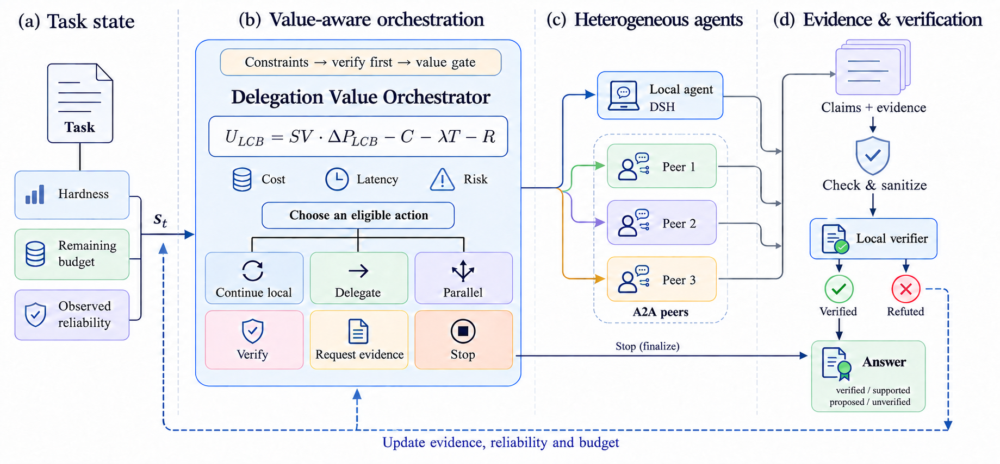

<div align="center">

# Harness DVO

### A Delegation Value Orchestrator for DeepSeek Harness and A2A agents

*At every step it asks: is delegating, fanning out or verifying worth more than carrying on locally?*


[How it works](#how-it-works) · [Quick start](#quick-start) · [API](#http-api) · [Guarantees](#guarantees) · [Evaluation](#evaluation) · [Architecture](#architecture) · [Docs](docs/)

</div>

**中文简介：** 本仓库实现了《DeepSeek Harness + A2A：委派价值驱动编排系统技术方案》（[docs/design/technical-design.zh.md](docs/design/technical-design.zh.md)）。它是一个中心化、风险受控的编排控制面：本地执行交给 DeepSeek Harness（DSH），远端异构 agent 通过 A2A v1.0 协议接入，而**委派价值编排器（DVO）**在每一步用可靠性的下置信界（LCB）估计“委派 / 并行 / 验证 / 继续本地 / 停止”的边际价值，并在硬预算、权限边界和确定性验证之下做出可审计、可回放的决策。设计与实现的逐条对应见 [docs/design-traceability.md](docs/design-traceability.md)。

---

Multi-agent systems usually escalate by rule: *hard task → more agents*. Harness DVO doesn't. It is a
**centralised, risk-controlled control plane**. It runs a local agent through
[DeepSeek Harness](https://github.com/deepseek-ai/deepseek-harness) (DSH), reaches independent,
black-box agents over the [A2A protocol](https://a2a-protocol.org/v1.0.0/specification), and at each
state it estimates whether another action is worth more than it costs:

```text
continue_local │ delegate(peer) │ parallel(peers) │ verify │ request_evidence(tier) │ stop
```

Every decision is persisted together with the exact input the policy saw, every candidate it rejected and *why*. So any
decision can be replayed bit-for-bit, and "why didn't it delegate?" always has an answer.

## Highlights

- **Value-gated escalation, not agent counting.** Delegation happens only if the gain computed from the peer's
  *lower confidence bound* on observed reliability beats cost, latency cost and a trust-tier risk penalty.
  Reasoning depth discounts every executor equally, so it can never inflate the agent count on its own.
- **Verify before trusting.** Only a local, deterministic verifier can mark a claim `verified`; a peer's or model's
  self-declared "verified" is demoted at the boundary. Final answers are labelled
  `verified | supported | proposed | unverified`.
- **Exactly-what-was-persisted delivery.** Remote submissions go through a transactional outbox with a
  deterministic A2A `messageId`. An unknown delivery is never blindly resent to a peer that doesn't
  de-duplicate. The official A2A reference server doesn't, and a contract test proves it.
- **Crash-safe.** An append-only, event-sourced log with CAS on the task revision. After a restart, remote tasks
  are re-attached by polling and orphaned local attempts are replaced by *new* ones. Terminal states never regress.
- **Hard budgets that actually hold.** In-flight reservations stop parallel attempts from jointly overshooting.
  Local token use is metered live, and the local run is killed at its token budget.
- **Least privilege by construction.** Data classification gates egress. Peers get a minimised, redacted task
  scope and a tier-limited view of prior evidence, never local context, credentials, file URIs or
  chain-of-thought. Artifacts pass host/MIME/size/SHA-256 checks and are quarantined, never executed.
- **Interoperable and isolated.** A2A v1.0 JSON-RPC, contract-tested against an independent mock *and* the official
  `@a2a-js/sdk` 1.2 server. DSH is reached only through its one-shot `headless --json` runner behind a
  version-locked, digest-pinned profile.

## How it works



A typical trace, taken verbatim from the bundled demo. The fake local runtime always answers 42; the reference
peer runs on the official A2A SDK:

```text
0 continue_local            LCB gain 0.3302 vs cost 0.0020 (net 0.3132)
1 verify(exact-answer)      unverified result and a deterministic verifier is available   → refuted
2 delegate(reference-peer)  LCB gain 0.1445 vs cost 0.0020 + risk 0.0200 (net 0.1172)
3 verify(exact-answer)      → verified
4 stop(sufficient_evidence) a result has been verified by a local verifier
succeeded (verified): 391 · $0.0027 · 1 remote call
```

The decision model, its formulas and every block reason are documented in [docs/policy.md](docs/policy.md).

## Quick start

Requirements: **Node.js 24 LTS** (`.nvmrc`). There are no native modules: SQLite comes from Node's built-in `node:sqlite`.

```bash
npm ci
npm run check          # architecture, secret scan, typecheck, lint, format, 187 tests + coverage gates
```

Run the end-to-end demo (fake local runtime + reference A2A peer on the official SDK):

```bash
npm run demo:peer      # terminal 1: reference A2A v1.0 peer on 127.0.0.1:9100
npm run demo:run       # terminal 2: "What is 17 * 23?" → local 42 refuted → delegated → 391 verified
```

Or the whole stack in containers: `docker compose up --build`, then submit tasks to `localhost:8080`.

Run the service against real DSH and real peers:

```bash
npm install --global @deepseek-ai/dsh@0.2.0-rc.1           # the version pinned in configs/runtime-lock.yaml
cp configs/peers.example.yaml configs/peers.yaml            # allowlist your peers (HTTPS only)
export HARNESS_SECRET_ORCHESTRATOR_DSH_DEEPSEEK_API_KEY=…   # resolved from secret://orchestrator/dsh/deepseek-api-key
npm run build && npm start                                  # or: node --conditions=@dvo/source apps/service/src/cli.ts serve
```

### CLI

```text
harness serve                          start the HTTP service (runs restart recovery first)
harness run --goal <text> [--expected <v>] [--classification c] [--local-only] [--json]
harness replay <taskId>                rebuild a task from its log and re-run every decision
harness export [--kind events|decisions] [--out file.jsonl]   redacted research export
harness peers check                    fetch and validate every allowlisted Agent Card
harness config check                   validate configuration (never prints secrets)
harness schemas                        print the EvidenceEnvelope JSON Schema
```

### HTTP API

| Method & path | Purpose |
|---|---|
| `POST /v1/tasks` | Submit a task (`Idempotency-Key` header: same key ⇒ same task, no second execution) |
| `GET /v1/tasks/:id` · `…/result` | State and attempts · final outcome (`202` while running) |
| `POST /v1/tasks/:id/cancel` | Best-effort cancel; late results are audited, never accepted |
| `POST /v1/tasks/:id/approvals` | Human approval for delegating `restricted` data |
| `GET /v1/tasks/:id/events` · `…/decisions` · `…/replay` | Redacted event log · decision records · determinism check |
| `GET /v1/peers` · `POST /v1/peers/:id/circuit/{reset,trip}` | Peer health and statistics · operator circuit control |
| `GET /healthz` · `/readyz` · `/metrics` | Liveness · readiness (store, local runtime, circuits) · Prometheus |

`/v1/*` requires `Authorization: Bearer <token>` when `http.apiTokenRef` is configured. Configuration lives in
[`configs/`](configs/): `service`, `peers`, `policy` and a pinned `runtime-lock.yaml`. Secrets are only ever
`secret://…` references, resolved from environment variables or a secrets directory. See [docs/operations.md](docs/operations.md).

## Guarantees

The design's invariants (§3.2) and acceptance criteria (§16.1), with the tests that enforce them:

| Guarantee | Mechanism | Enforced by |
|---|---|---|
| Duplicate submissions cause no duplicate remote side effects | client idempotency key, outbox, deterministic `messageId` | `engine.test` · `a2a-bridge.contract.test` |
| An unknown submission to a non-de-duplicating peer is never resent | outbox `submission_unknown` state, delivery classification | contract test **and** official-SDK interop test |
| Timeouts, cancels, duplicates and reordering never regress state | legal-transition tables, monotonic observation, audit-only late events | `state-machines.test` · `a2a-bridge.contract.test` · `engine.test` |
| Restart recovers non-terminal remote tasks with the full trace | event log + outbox re-attachment, orphan replacement | `recovery.test` (real SQLite + real A2A) |
| No new delegation after the budget or deadline | hard stops, reservations, deadline timers | `rule-policy.test` · `engine.test` |
| Deterministic degradation without extension / streaming / cancel support | tier-0 Data Part fallback, polling only, local `cancel_requested` | `a2a-bridge.contract.test` |
| Credentials and sensitive data never reach traces, metrics or peers | Redactor at ingress, gateway, store, logs; egress guard | `boundary.test` · `store-contract.test` · `service.test` |
| Local and remote results share one `NormalizedExecutionResult` | bridges normalise; gateway decides trust | `dsh-bridge.contract.test` · `a2a-bridge.contract.test` |
| Every final result carries `verified / supported / proposed / unverified` | finalizer | `engine.test` |

## Evaluation

The controlled-DAG benchmark (design §14 M4) uses seeded arithmetic dependency graphs with exact answers, so every
outcome is scored by a deterministic verifier, never an LLM judge. Four simulated executors have known competence
profiles: a local model that degrades with depth, an accurate but expensive specialist, a cheap overconfident peer,
and a slow flaky one. Every strategy runs **compute-matched** under the same hard budget: $0.06, ≤ 3 remote calls,
90 s. Results are means over 3 seeds × 300 tasks, reproducible with `npm run eval:dag`:

| Strategy | Verified success | Mean cost | p95 latency | Remote calls |
|---|---|---|---|---|
| Single agent (local only) | 66.4 % | $0.0031 | 7.4 s | 0.00 |
| Fixed topology (fan out to all peers) | 95.3 % | $0.0258 | 15.8 s | 1.77 |
| Confidence-gated (τ = 0.8) | **99.6 %** | **$0.0151** | 38.2 s | 0.71 |
| **DVO** (value $1 per success) | 99.2 % | $0.0259 | **23.5 s** | 1.77 |
| DVO (value $0.10 per success) | 66.4 % | $0.0031 | 7.4 s | 0.00 |
| DVO + ε = 0.1 exploration ($0.10) | 98.3 % | $0.0180 | 34.1 s | 1.02 |

What these numbers do and don't show (details in [docs/evaluation.md](docs/evaluation.md)):

- With a deterministic verifier available, **"verify, then escalate"** is what matters. Confidence-gating, which
  shares DVO's verification step, is the cheapest near-perfect strategy here. DVO buys ~40 % lower tail latency
  by hedging with parallel peers on decomposable tasks, at a higher mean cost. None of the strategies dominates
  the others on all three objectives.
- **The LCB gate is conservative by design.** At a low task value it never tries unproven peers and stays at
  local-only quality: a cold-start trap. Controlled exploration (design §7.2) breaks it: +32 points at the same task value, for ~70 % of
  the cost of DVO at $1 per success. This is exactly why the policy logs propensities for off-policy learning.
- Making the local model overconfident changes **nothing** in this setting (bit-identical results): with
  verification in the loop, self-reported confidence never drives a decision.

## Architecture

A TypeScript monorepo with a one-way dependency graph. `core` depends on nothing, and infrastructure enters only
through ports. `npm run check:architecture` enforces this on every build.

| Package | Responsibility | Must not |
|---|---|---|
| [`core`](packages/core) | domain model, state machines, event-sourced projection, ports, budgets, statistics | depend on anything |
| [`policy`](packages/policy) | DVO rules + LCB gating, baselines, hardness heuristics, calibration, off-policy estimators | call executors |
| [`scheduler`](packages/scheduler) | semaphores (global, per executor), deadlines, retry with jitter, circuit breakers | interpret outputs |
| [`evidence`](packages/evidence) | EvidenceEnvelope schema, redaction, injection screening, artifact checks, egress guard | treat free text as fact |
| [`verifier`](packages/verifier) | exact-answer, regex, sandboxed command, artifact-digest verifiers | use an LLM judge |
| [`trace`](packages/trace) | SQLite / in-memory store, replay, research export, Prometheus metrics | store secrets |
| [`dsh-bridge`](packages/dsh-bridge) | the **only** package that knows DSH: headless process executor | leak DSH types |
| [`a2a-bridge`](packages/a2a-bridge) | Agent Card discovery, JSON-RPC client, outbox-driven submit, polling, cancel | decide trust |
| [`orchestrator`](packages/orchestrator) | ingress, per-task actor loop, finalizer, recovery, reliability tracking | touch SDKs directly |
| [`testkit`](packages/testkit) | fake clock, scripted executors, spec-conformant mock A2A peer, fake `dsh`, chaos wrappers | ship to production |
| [`apps/service`](apps/service) | composition root: config, secrets, HTTP API, CLI, logging | contain business logic |

Architecture, state machines and data flow: [docs/architecture.md](docs/architecture.md). Decisions and their
alternatives: [docs/adr/](docs/adr/). Threat model: [docs/security.md](docs/security.md).

## Status and limitations

This is the design's MVP scope (milestones M0–M4) plus the V2 hooks, *not* the learned policy itself.

- **DSH is exercised through a faithful fake in CI.** Against the published `@deepseek-ai/dsh@0.2.0-rc.1`, the
  bridge was additionally validated for the version probe, the overlay (`--dump-config` shows the read-only sandbox,
  `never` approval, disabled subagents and an activated permission preset), and the event stream up to the model call,
  including DSH's structured `turn_end.reason` objects. That validation found and fixed two incompatibilities the fake
  had hidden. A full model run needs a DeepSeek API key, which CI deliberately doesn't have.
- **A2A: JSON-RPC binding with polling only**, as the MVP specifies. Streaming, push notifications, gRPC and REST
  bindings, and multi-hop delegation are out of scope. Remote peers are read-only and single-hop.
- **Learning:** exploration logging, IPS/SNIPS/doubly-robust estimators, Platt calibration and a coverage-gated
  policy wrapper exist. Training a value model on real traces (M5) is future work.
- **Evaluation:** the controlled-DAG family is implemented. `tool-use` and `code-repair` are specified in
  [evals/](evals/) but not yet built.

## Development

```bash
npm run dev            # service from TypeScript sources (Node type stripping, no build)
npm test               # 187 unit, contract, integration and chaos tests (virtual time where possible)
npm run test:coverage  # with gates: lines ≥ 80 %, branches ≥ 70 %
npm run eval:dag -- --tasks 300 --seed 7 [--scenario overconfident-local]
npm run build          # tsc -b → dist/ for every package
```

See [CONTRIBUTING.md](CONTRIBUTING.md) for the review rules. Policy changes need a replay snapshot; schema changes
need a compatibility test; runtime upgrades must pass the full contract and chaos suites.

## License

[Apache-2.0](LICENSE).
