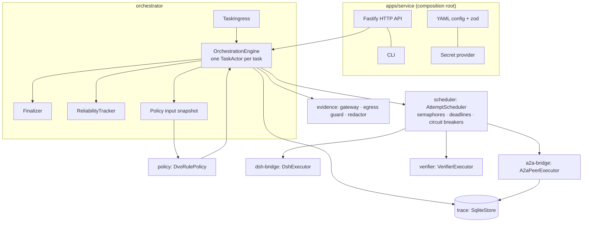
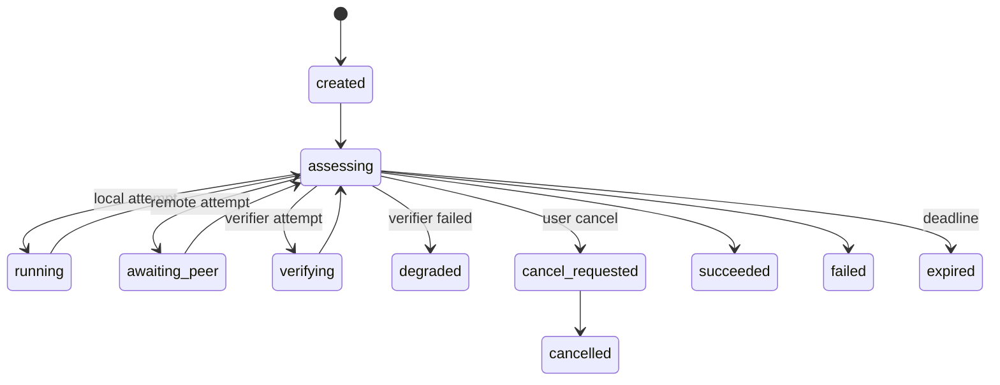
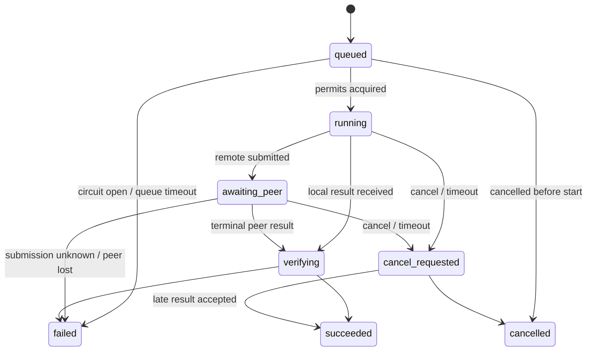

# Architecture

Harness DVO is a single-process control plane (design §4.2) organised as a ports-and-adapters monorepo.
This document covers the runtime structure, the two state machines, the persistence model and the data that
crosses each boundary.

## Components



* **Composition root (`apps/service`)**: the only place where concrete adapters are instantiated from
  configuration. Nothing below it reads environment variables or files on its own.
* **Engine (`orchestrator`)**: one `TaskActor` per live task. Every mutation of a task (decision,
  progress, result, cancel, deadline) runs as one job on that actor's mailbox. A task therefore has a single
  in-process writer, and the store's compare-and-set only trips on a genuine cross-process conflict.
* **Policy (`policy`)**: a pure function `PolicyInput → PolicyDecision`. It never performs I/O; the engine
  builds its input from the task projection, cached executor capabilities, circuit states and reliability statistics.
* **Scheduler (`scheduler`)**: runs attempts under a global semaphore and per-executor semaphores (so a slow
  peer cannot starve the others), turns deadlines into cancellation, consults circuit breakers, and guarantees
  that every launched attempt settles exactly once with a normalised result, even if an executor ignores cancel.
* **Bridges**: `dsh-bridge` and `a2a-bridge` normalise their runtimes into `NormalizedExecutionResult`. They
  check structure; they do not decide trust.
* **Evidence gateway (`evidence`)**: decides what a result may *claim*. It demotes self-verification,
  downgrades tiers, rejects artifacts outside policy, redacts secrets and quarantines injection risks.

## Dependency rule

```text
core ◀── evidence ◀── verifier
  ▲  ◀── scheduler ◀── a2a-bridge (also evidence)
  │  ◀── policy
  │  ◀── trace
  │  ◀── dsh-bridge (also evidence)
  └───── orchestrator (core, evidence, policy, scheduler, trace, verifier)
             ▲
        apps/service (everything)
```

`scripts/check-architecture.mjs` fails the build on any import outside these edges, and enforces the adapter
boundaries: only `dsh-bridge` may reference DeepSeek Harness, only `a2a-bridge` A2A SDKs, only `trace` SQLite.

## Task lifecycle



The phase is derived from the active attempts (verifier > peer > local). The engine consults the policy whenever
nothing is in flight. While attempts *are* in flight it consults the policy only when (a) a result arrived and a
deterministic verifier is free (hedged verification), or (b) something has been verified (early stop, which cancels
the remaining attempts as *superseded*). Any other choice made in those situations is discarded unrecorded, so
in-flight escalations are never thrashed. A safety valve (`engine.maxDecisions`) bounds decision loops.

## Attempt lifecycle (design §10.1)



Two conservative additions to the design's diagram: `queued → cancelled`, and `awaiting_peer → failed` for
infrastructure failures without a peer result. Illegal or out-of-order inputs never change state. They are
recorded as `attempt.transition_rejected` or `attempt.late_result` audit events.

## Persistence: event sourcing with a transactional outbox

Every change is an immutable `DomainEvent` appended to the task's log. The task projection (`TaskState`) is a pure
left fold over the log (`core/projection.ts`), used identically by the live engine, the SQLite projection tables and
the replayer. A commit writes, in one `BEGIN IMMEDIATE` transaction:

1. the new events (unique `event_id`, unique `(task_id, revision)`);
2. the updated projection row, guarded by `WHERE revision = expected` (CAS);
3. per-attempt projection rows and extracted decision rows;
4. outbox rows for new remote attempts.

**Budget accounting is part of the fold.** Creating an attempt *reserves* its cost estimate and remote call. A
remote call is charged when the request may have left the process (`remote_submitted` or `submission_unknown`).
Cost is charged from reported usage when the result is recorded, or at the reserved estimate if nothing is
reported. Admission checks count committed spend plus reservations, which is what keeps budgets hard under
parallelism.

### Outbox states (design §11.1)

```text
pending ──▶ sending ──▶ submitted
              │  ▲
              ▼  │ (de-duplicating peers only)
     submission_unknown
any non-submitted ──▶ abandoned
```

`pending` means the request never left the process, so it is always safe to send. A row found in `sending` after
a crash is treated as `submission_unknown`. The A2A `messageId` is the UUIDv5 of the idempotency key, so a resend
is byte-identical. Only peers configured with `dedupSupported: true` are ever resent to.

## Restart recovery (design §10.2)

`OrchestrationEngine.recover()` runs before the HTTP listener opens:

| Attempt found | Action |
|---|---|
| remote, outbox `submitted` | re-attach and poll `GetTask`; never resend |
| remote, outbox `pending` | send (it never left the process) |
| remote, outbox `sending` / `submission_unknown` | resend only to de-duplicating peers, otherwise fail with `submission_unknown` |
| local or verifier | fail as `orphaned_on_restart`; the policy may retry with a **new** attempt |
| any, task had a cancel request | cancel right after re-attaching |

## What crosses each boundary

| Boundary | Outbound | Inbound |
|---|---|---|
| → DSH (child process) | redacted goal + untrusted-evidence block + response contract, over **stdin**; allowlisted env + injected credential | NDJSON events; `thinking` dropped, stderr reasoning dropped; final text parsed into an envelope |
| → A2A peer | minimised task scope; tier-limited envelope (extension) or tier-0 Data Part; idempotency key only with the extension; `traceparent` | Task/Artifact → envelope (extension-tagged, shaped data, or synthesized tier 0), raw parts → quarantine |
| → verifier | candidate envelope + locally configured recipe | verdicts; only source allowed to set `verified` |
| → store / logs / metrics | redacted events and projections (Redactor as last line of defence) | — |
| → HTTP clients | task view, outcome, redacted events and decisions | zod-validated task specs |
