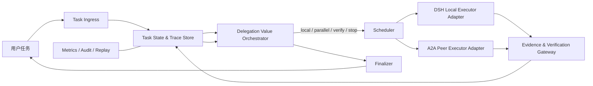
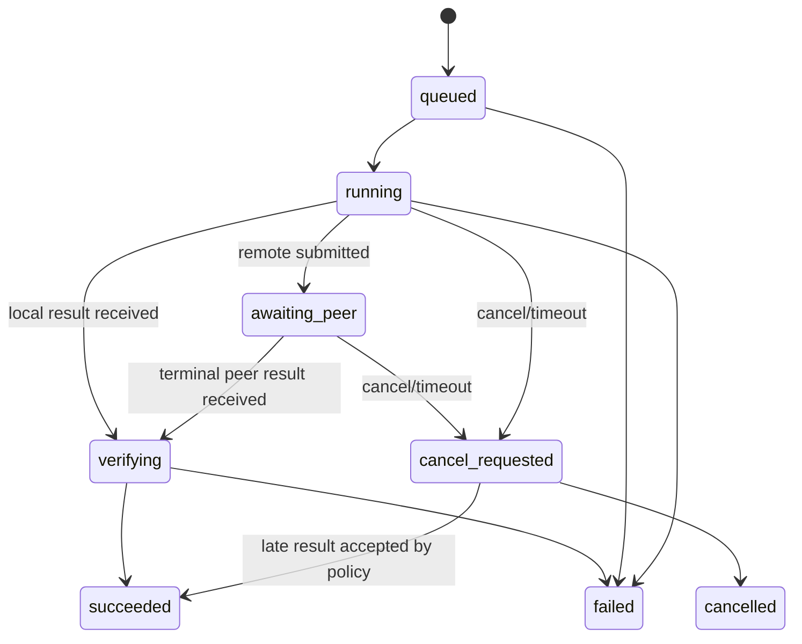

# DeepSeek Harness + A2A：委派价值驱动编排系统技术方案

> **文档状态**：可实施设计（MVP → 研究型系统）  
> **日期**：2026-09-28  
> **推荐实现语言**：TypeScript / Node.js  
> **目标运行时**：DeepSeek Harness（DSH）本地执行 + A2A 异构远端执行  
> **本文不依赖某个未固定的 DSH alpha API；所有 DSH 接触点经适配层隔离。**

## 1. 目标与结论

本项目实现一个**中心化、风险受控的多智能体编排层**。它不把“任务越难就派更多 agent”当作规则，而是在每个执行状态估计：

> 此刻额外委派、并行求解、索要证据或触发验证，是否比继续本地执行更值得？

系统由三层组成：

- **DSH**：本地 agent、工具、子代理和工作流的可替换运行时；
- **A2A**：与独立、黑箱远端 agent 通信的互操作数据面；
- **Delegation Value Orchestrator（DVO）**：本项目的核心控制面，依据任务状态、预算、验证结果和历史可靠性选择下一步动作。

首个可交付版本必须是一个可靠的工程系统，而非训练复杂策略的原型：

1. 本地 DSH 子代理与一个或多个 A2A peer 均可被统一调度；
2. 所有委派均可追踪、取消、超时、重试和幂等恢复；
3. 对 A2A peer 只交换最小必要的任务与证据，不传递密钥、完整本地上下文或原始 chain-of-thought；
4. 在固定预算下，基于规则和校准信号选择 `local / delegate / parallel / verify / stop`；
5. 输出可复放的 trace，为后续学习“委派边际价值”提供数据。

## 2. 范围与非目标

### 2.1 MVP 范围

| 范围 | MVP 要求 |
|---|---|
| 本地执行 | 调用 DSH 的一个稳定子代理/工作流入口；失败时可返回结构化错误 |
| 远端执行 | 对 A2A `Agent Card` 发现、任务提交、轮询结果、取消和 artifact 拉取 |
| 编排 | 中心控制器选择单 agent、一次委派、有限并行、验证或停止 |
| 消息 | 版本化的 `EvidenceEnvelope`，含 claim、证据、假设、置信度和验证提示 |
| 状态 | SQLite 或 JSONL 持久化，支持重启后恢复和 trace 回放 |
| 可观测性 | 每次 decision、请求、响应、成本、延迟、失败和恢复均带 trace ID |
| 安全 | peer allowlist、预算上限、工具权限隔离、日志脱敏、artifact 完整性校验 |

### 2.2 明确不做

- 不在 MVP 中通过 DSH 热装载/卸载插件来改变拓扑；所有可能使用的能力在进程启动时组合完成。
- 不把 DSH 的实验性 Agent Teams 当作跨 runtime 消息总线。
- 不把 ACP（Agent Client Protocol）误当成 A2A；两者的对端、生命周期和安全边界不同。
- MVP 固定为**中心星型、单跳、只读远端**：远端 peer 不能继续委派，不能改写主工作区，也不继承本地工具权限。
- MVP 只使用受控 A2A endpoint 的轮询；不开放公网 webhook、push callback、跨 runtime continuation 或共享任务板。
- 不训练端到端强化学习编排器；先收集可靠、带 counterfactual exploration 标记的运行数据。
- 不允许远端 peer 直接获得本地 shell、文件系统、模型密钥、用户私密上下文或执行权限。
- 不将“支持 A2A”表述为“远端 agent 一定可信或一定会正确完成任务”。

## 3. 事实边界与设计原则

### 3.1 名词与边界

| 名词 | 在本方案中的角色 | 不应假设的能力 |
|---|---|---|
| DeepSeek Harness（DSH） | 本地 agent runtime 与子代理/工作流宿主 | 不自带 A2A peer provider；开发预览版 API 不稳定 |
| A2A | 独立 agent 的发现、Task、Message、Artifact 与异步状态传输 | 不负责判断 peer 是否可靠、任务是否值得委派或消息是否语义正确 |
| ACP | DSH 可使用的客户端/编码 agent 后端之一 | 不是跨组织的 peer-to-peer A2A 协议 |
| DVO | 本项目实现的控制器 | 不直接执行业务工具；只作预算、调度和证据决策 |

DSH 的官方设计将能力放在可组合插件中，并已有子代理和 workflow 能力；其当前版本仍可能有 breaking changes。因此 DSH 只能被封装在本地执行适配器后，不能渗入核心领域模型。A2A 的规范面向独立、可为黑箱的 agent，核心对象是 Agent Card、Task、Message 和 Artifact，且支持扩展；本方案通过可选扩展传递协作提示，而不修改核心协议。

### 3.2 不变式

以下不变式必须通过代码、测试和运行时审计共同保证：

1. **一切外部副作用均有 owner、deadline、budget 与 idempotency key。**
2. **同一 `attemptId` 的终态不可逆；重复或乱序事件不得改变终态。**
3. **取消是尽力而为，但本地状态必须立即标注为 `cancel_requested`，并保留迟到结果的审计记录。**
4. **Agent Card 声明是候选信息，不是信任证据。**实际可靠性由本地 trace 统计。
5. **远端数据默认不可信。**所有 structured data、artifact URI、MIME type、大小和 hash 均在边界校验。
6. **日志不保存密钥、认证头、完整用户隐私上下文或原始思维链。**
7. **策略永远不能突破硬预算、权限边界和人工审批要求。**

## 4. 总体架构



### 4.1 模块职责

| 模块 | 责任 | 禁止承担的责任 |
|---|---|---|
| `task-ingress` | 创建 task、校验预算和权限、生成 trace | 直接选择模型或拓扑 |
| `orchestrator` | 基于状态选择动作，产生可审计 decision | 直接调用 DSH/A2A SDK |
| `scheduler` | 并发控制、deadline、队列、重试、取消 | 解释模型输出或替代验证器 |
| `dsh-executor` | 执行本地子代理/工作流，规范化结果 | 包含 A2A 协议细节 |
| `a2a-executor` | Agent Card、Task、Message、Artifact 的协议适配 | 决定是否信任远端结果 |
| `evidence-gateway` | 解析、脱敏、校验和提升证据等级 | 直接将自由文本视为已验证事实 |
| `verifier` | 运行领域 checker、单元测试或规则验证 | 用 LLM judge 取代确定性验证 |
| `trace-store` | 保存 append-only event、快照、指标和 replay 索引 | 保存密钥或未脱敏上下文 |

### 4.2 推荐进程划分

MVP 采用一个 Node.js 服务进程加本地 SQLite：

```text
orchestrator-service
├── HTTP/API ingress
├── policy + scheduler
├── DSH adapter（进程内或受控子进程）
├── A2A HTTP/JSON-RPC client
├── verifier workers
└── SQLite + append-only trace files
```

不要在 MVP 过早拆成微服务。等到并发、隔离或远端 peer 数量成为实际瓶颈时，再将 A2A adapter 和 verifier 拆为独立 worker，并保留同一领域事件协议。

## 5. 核心领域模型与接口

### 5.1 统一身份

所有跨模块调用必须携带以下标识：

```ts
type TaskId = string;
type AttemptId = string;
type TraceId = string;
type EventId = string;
type PeerId = string;

interface Correlation {
  taskId: TaskId;
  attemptId?: AttemptId;
  traceId: TraceId;
  eventId: EventId;
  parentEventId?: EventId;
  idempotencyKey: string; // 本项目的 application-level key；第三方 A2A peer 未必实现去重
  occurredAt: string; // ISO-8601 UTC
}
```

- `taskId`：用户可见的逻辑任务。
- `attemptId`：一次可取消、可重试的执行尝试；重试必须创建新 attempt。
- `traceId`：贯穿 DSH、本地 verifier 与 A2A 请求的追踪标识。
- `eventId`：不可变事件主键；所有消费方去重。
- `idempotencyKey`：同一次远端提交和本地副作用的去重键。对本项目控制的 peer 可作为去重扩展；对第三方 peer 不能假设它提供 exactly-once 语义。

### 5.2 任务状态与预算

```ts
type TaskPhase =
  | "created"
  | "assessing"
  | "running"
  | "awaiting_peer"
  | "verifying"
  | "degraded"
  | "cancel_requested"
  | "succeeded"
  | "failed"
  | "cancelled"
  | "expired";

interface Budget {
  maxCostUsd: number;
  maxInputTokens: number;
  maxOutputTokens: number;
  maxRemoteCalls: number;
  maxParallelAttempts: number;
  deadlineAt: string;
}

interface TaskState {
  taskId: TaskId;
  phase: TaskPhase;
  revision: number;                 // CAS 更新
  userGoal: string;                 // 已脱敏的最小任务描述
  budget: Budget;
  spent: { costUsd: number; inputTokens: number; outputTokens: number; remoteCalls: number };
  remainingMs: number;
  hardnessProfile: HardnessProfile;
  reliability: ReliabilitySnapshot;
  activeAttempts: AttemptId[];
  finalAttemptId?: AttemptId;
}
```

### 5.3 Hardness 画像：特征而非真值

```ts
interface HardnessProfile {
  reasoningDepth: number;       // 0..1，关键路径/步骤复杂度的归一化估计
  skillBreadth: number;         // 需要的工具、领域、模型能力跨度
  dependencyCoupling: number;   // 子任务是否可独立完成
  informationFragmentation: number;
  ambiguity: number;
  verifiability: number;        // 高表示存在可靠自动 verifier
  currentFailureRisk: number;   // 来自执行轨迹的后验风险
  confidenceSource: "heuristic" | "calibrated-model" | "manual";
}
```

不得只根据 `reasoningDepth` 增加 agent 数量。MVP 中这组值可以由启发式、任务元数据和 verifier 可用性给出；后续版本再以历史 trace 校准。

### 5.4 动作和决策记录

```ts
type OrchestrationAction =
  | { kind: "continue_local" }
  | { kind: "delegate"; peerId: PeerId; evidenceTier: 0 | 1 | 2 }
  | { kind: "parallel"; peerIds: PeerId[]; evidenceTier: 0 | 1 | 2 }
  | { kind: "verify"; verifierId: string }
  | { kind: "request_evidence"; attemptId: AttemptId; nextTier: 1 | 2 }
  | { kind: "stop"; reason: "budget" | "deadline" | "sufficient_evidence" | "unsafe" };

interface DecisionRecord extends Correlation {
  stateRevision: number;
  candidateActions: Array<{
    action: OrchestrationAction;
    estimatedGain: number;
    lowerConfidenceBound: number;
    estimatedCostUsd: number;
    estimatedLatencyMs: number;
    blockedBy?: string[];
  }>;
  selected: OrchestrationAction;
  policyVersion: string;
  decisionReason: string;
}
```

决策必须保留未选择动作及其排除原因。这是线上排障、回放、策略评估和后续 off-policy 学习的基础。

## 6. Evidence Contract：跨 agent 的最小可信载荷

### 6.1 原则

跨 runtime peer 可以是黑箱，因此消息不能假设共享工作记忆，也不应要求传递原始 CoT。统一使用可验证证据包：

- **Tier 0 — 摘要**：结论、限制条件、下一步请求。
- **Tier 1 — Claim/Evidence**：可定位的 claim、来源/工具结果摘要、置信度、依赖与反例。
- **Tier 2 — 可复现证据**：artifact digest、测试命令/验证 recipe、输入输出摘要及 provenance。

只有当 DVO 认为 Tier 0 不足以降低不确定性，且预算允许时，才升级证据层级。

### 6.2 数据结构

```ts
interface EvidenceEnvelope {
  schemaVersion: "1.0";
  correlation: Correlation;
  tier: 0 | 1 | 2;
  taskScope: string;
  claims: Array<{
    id: string;
    statement: string;
    confidence: number;          // 自报值，仅作弱信号
    assumptions: string[];
    dependencies: string[];
    status: "proposed" | "supported" | "verified" | "refuted";
  }>;
  evidence: Array<{
    kind: "citation" | "tool-result" | "test-result" | "artifact" | "observation";
    summary: string;
    uri?: string;
    sha256?: string;
    mimeType?: string;
    bytes?: number;
    verifierHint?: string;
  }>;
  requestedNextAction?: string;
  redactionApplied: boolean;
}
```

### 6.3 入站校验

1. JSON Schema 验证、版本兼容检查和字段大小限制。
2. Artifact 下载前先检查 URL allowlist、MIME type、大小上限和 SHA-256。
3. `status: verified` 只有在本地 verifier 生成独立事件后才允许显示为“已验证”。
4. 未知字段保留在原始审计记录中，但不得直接进入模型提示词。
5. 所有入站文本经 prompt-injection 风险标记；高风险 artifact 只进入隔离 verifier。

## 7. 委派价值策略

### 7.1 MVP：规则 + 校准门控

MVP 不需要声称因果最优，只做可解释、可测试的门控。

```text
若已超过 deadline / 预算 / 并发上限：stop 或 local fallback
若存在确定性 verifier 且当前产物未验证：verify
若本地结果置信度低、任务可分解、候选 peer 有合适技能且预估收益大于成本：delegate
若两个独立来源的关键 claim 冲突且仍可验证：parallel 或 request_evidence
若 peer 历史失败率、时延或安全等级超过阈值：禁止或降级该 peer
否则：continue_local
```

硬约束优先于策略分数：

```ts
function mayEscalate(state: TaskState, action: OrchestrationAction): boolean {
  return state.remainingMs > MIN_ESCALATION_WINDOW_MS
    && state.spent.costUsd < state.budget.maxCostUsd
    && state.spent.remoteCalls < state.budget.maxRemoteCalls
    && state.activeAttempts.length < state.budget.maxParallelAttempts;
}
```

### 7.2 V2：委派边际价值学习

在 MVP 已稳定后，才引入学习模型：

1. 对部分安全、低风险任务随机探索 `no-op / delegate / parallel / verify`；
2. 记录 logging policy、候选动作、实际动作、结果、成本和延迟；
3. 使用 doubly robust / contextual value estimation 估计动作收益；
4. 用校准后的下置信界（LCB）而非点估计决定是否升级；
5. 未满足 coverage 或预算条件时退回 MVP 规则。

这样避免把纯观察日志误表述为严格因果结论。

## 8. DSH 集成设计

### 8.1 隔离层

核心层只依赖以下抽象：

```ts
interface ExecutionRequest {
  correlation: Correlation;
  prompt: string;
  expectedSchema?: object;
  budget: Pick<Budget, "maxInputTokens" | "maxOutputTokens" | "deadlineAt">;
  evidence?: EvidenceEnvelope;
}

interface ExecutionHandle {
  attemptId: AttemptId;
  cancel(): Promise<void>;
  result(): Promise<NormalizedExecutionResult>;
}

interface Executor {
  id: string;
  kind: "dsh-local" | "a2a-peer" | "verifier";
  capabilities(): Promise<ExecutorCapabilities>;
  start(request: ExecutionRequest): Promise<ExecutionHandle>;
}
```

`DshExecutor` 是这个接口的一种实现。它可以使用 DSH 的稳定子代理或 workflow 入口，但不得让 DSH 内部 `Session`、`Context` 或实验性 Team 类型泄漏到 `orchestrator-core`。

### 8.2 推荐实现方式

- 初期使用 **one-shot、受限深度** 的本地 DSH 子代理，避免递归委派失控。
- workflow 仅用于明确可并行的工作项；单个远端查询不要为了形式统一而启动 workflow。
- 本地 executor 为每次调用设置 deadline、输出 token 上限、工具 allowlist 和明确的结构化输出要求。
- DSH 版本、commit、配置 profile 和模型 route 写入每条 trace。
- 不依赖实验性 Agent Teams 的 mailbox 或 shared checkout 来实现跨 runtime 协作。

### 8.3 版本漂移防护

- 用 `dsh-bridge` 单独 npm package 包装所有 DSH API。
- 对 bridge 写契约测试：成功、超时、取消、结构化输出失败、子代理崩溃。
- CI 锁定 DSH commit/版本，升级必须通过独立 compatibility pipeline。
- 运行时记录 `runtime.name`、`runtime.version`、`profileDigest`，使 trace 可解释。

## 9. A2A 集成设计

### 9.1 Peer 生命周期

```text
discover Agent Card
    → validate HTTPS/allowlist/schema
    → cache profile with TTL
    → select candidate according to skills + observed reliability + budget
    → persist local outbox + submit Task with application-level idempotency key and EvidenceEnvelope
    → MVP: poll; later: optional stream / notification
    → retrieve & validate artifacts
    → normalize terminal result
    → update peer reliability statistics
```

### 9.2 与 A2A 的对象映射

| 本方案对象 | A2A 对象 | 规则 |
|---|---|---|
| `PeerProfile` | Agent Card | 缓存并带 TTL；不能视为可信性能承诺 |
| `ExecutionRequest` | Message / Task | 任务描述必须最小化、脱敏；携带本项目的 idempotency key 扩展 |
| `EvidenceEnvelope` | Data Part / File Part / optional extension | peer 不支持扩展时退回普通 Data Part |
| `NormalizedExecutionResult` | Task status + Artifact | 先本地校验，再更新 task state |
| `cancel()` | Task cancel | 远端取消失败不回滚本地审计状态 |

### 9.3 A2A 兼容与降级

1. 只使用固定版本范围内的核心 A2A 操作；版本由配置锁定。
2. 扩展使用独立 URI，例如 `urn:research:dvo:evidence-envelope:v1`。
3. peer 不支持扩展时：将 Tier 0 载荷编码为普通结构化 Data Part；禁用 Tier 2 artifact 自动执行。
4. peer 不支持 streaming 时：退回带指数退避的 polling；MVP 默认使用 polling，即使 peer 支持 streaming。
5. peer 不支持 cancellation 时：本地将 attempt 标为 `cancel_requested`，忽略不再需要的终态结果，但保留审计。

### 9.4 认证与网络

- MVP 只连接显式 allowlist 中的 HTTPS endpoint。
- 认证信息由专用 secret provider 注入；不得写进 task、trace 或错误文本。
- 每个 peer 单独配置 credential、超时、并发、最大 artifact 大小和可调用技能。
- 对跨信任域 peer 使用 egress proxy、TLS 校验、请求限流和 circuit breaker。
- 远端 endpoint 不得由模型自由生成后直接访问；必须先经 policy allowlist。

## 10. 执行状态机与故障恢复

### 10.1 Attempt 状态机



### 10.2 必须实现的恢复规则

| 故障 | 处理规则 |
|---|---|
| 网络超时但提交状态不明 | 写入 `submission_unknown`；仅对本项目控制且明确支持去重的 endpoint 使用同一 key 查询/重试，第三方 peer 禁止盲目重发 |
| 重复 polling 结果 | 以本地 `attemptId + remote task ID + observation digest` 去重 |
| 结果乱序 | 只接受合法状态迁移；迟到事件写审计但不得逆转终态 |
| 服务重启 | 从 trace snapshot 恢复未终态 attempt；重新查询远端 Task |
| 本地子代理崩溃 | 记录异常类别；按 retry policy 新建 attempt，不复用失败 attempt |
| verifier 不可用 | 标记 `degraded`；禁止把未验证结果升级为 verified |
| peer 连续失败 | circuit breaker 打开，移出候选池直到冷却或人工恢复 |
| 达到预算/截止时间 | 取消未完成 attempt；选择已有的可验证结果或明确失败 |

### 10.3 幂等与并发控制

- 对 `TaskState` 使用 revision/CAS 更新。
- 事件为 append-only；投影可重建。
- 同一 `taskId` 的活跃 attempt 数不超过 `maxParallelAttempts`。
- 每个 peer 设置独立 semaphore，避免一个慢 peer 挤占全局并发。
- 所有 retry 均使用指数退避、抖动和明确最大次数；只对可重试错误执行。

## 11. 存储、可观测性与回放

### 11.1 MVP 存储

SQLite 足够支持单节点 MVP：

| 表 | 关键字段 |
|---|---|
| `tasks` | `task_id`, `phase`, `revision`, `budget_json`, `created_at` |
| `attempts` | `attempt_id`, `task_id`, `executor_id`, `status`, `deadline_at` |
| `events` | `event_id`, `trace_id`, `attempt_id`, `type`, `payload_redacted`, `occurred_at` |
| `outbox` | `outbox_id`, `attempt_id`, `request_digest`, `state`, `next_retry_at` |
| `decisions` | `event_id`, `policy_version`, `candidates_json`, `selected_json` |
| `peers` | `peer_id`, `card_digest`, `last_seen_at`, `trust_tier` |
| `peer_stats` | `peer_id`, `skill`, `success_count`, `failure_count`, `latency_histogram` |
| `artifacts` | `artifact_id`, `sha256`, `uri`, `bytes`, `validation_status` |

事件 payload 使用 JSON，但数据库只保留脱敏后内容；大 artifact 存对象存储或隔离本地目录，通过 digest 引用。

远端提交采用 **transactional outbox**：同一数据库事务先写入 attempt、固定请求 digest 和 outbox 记录，再由 worker 发送。收到远端 task ID 后再写入映射。这样进程在发送前后崩溃时都能区分“尚未发送”和“提交状态未知”；后者默认保守处理，不能声称 exactly-once。

### 11.2 指标

至少输出以下指标：

- 每 task：成功率、总成本、token、wall-clock latency、p50/p95/p99、最终验证状态；
- 每决策：候选动作、预测收益、实际动作、拒绝原因；
- 每 peer：成功率、超时率、取消率、平均/尾部延迟、artifact 校验失败率；
- 每消息：Tier、字节数、是否改变后续决策、是否带来可验证增益；
- 系统：队列长度、重试次数、circuit breaker 状态、恢复耗时、预算违约数。

### 11.3 Trace 回放

回放器应支持：

1. 从某个 `taskId` 重建状态机；
2. 用真实结果重放 decision；
3. 用 mock executor 替换 DSH/A2A，验证策略确定性；
4. 标记当时未执行但被评估过的候选动作；
5. 导出脱敏 JSONL，供研究分析与复现实验使用。

## 12. 安全、隐私与权限模型

### 12.1 数据分级

| 等级 | 示例 | 能否发给 A2A peer |
|---|---|---|
| `public` | 已公开任务描述、公开基准数据 | 可以 |
| `internal` | 脱敏的中间结论、非敏感日志摘要 | 仅 allowlisted peer，最小化发送 |
| `restricted` | 私有仓库片段、用户文件、未发布实验 | 默认禁止；须人工审批和专用沙箱 |
| `secret` | API key、cookie、令牌、认证头 | 永远禁止 |

### 12.2 权限规则

- 远端 peer 不拥有本地工具权限；它只能返回数据或 artifact。
- 任何写文件、提交代码、发送邮件、购买/部署等副作用必须由本地受控 executor 执行。
- 如果 task 被标记为 `restricted`，DVO 默认仅允许本地 DSH executor。
- artifact 验证在隔离目录/容器中运行，禁止继承环境变量和用户凭据。
- 每次跨域委派记录 `dataClassification`、`reason` 和人工审批状态。

## 13. 推荐仓库结构

```text
harness-orchestrator/
├── apps/
│   └── service/                    # HTTP/API 与进程装配
├── packages/
│   ├── core/                       # 领域模型、状态机、策略接口
│   ├── policy/                     # MVP 规则、校准模型、策略版本
│   ├── scheduler/                  # 并发、deadline、retry、cancel
│   ├── dsh-bridge/                 # 唯一允许依赖 DSH 的 package
│   ├── a2a-bridge/                 # Agent Card/Task/Artifact 协议适配
│   ├── evidence/                   # schema、redaction、artifact 验证
│   ├── verifier/                   # test/规则/领域验证器
│   ├── trace/                      # event store、投影、replay、metrics
│   └── testkit/                    # mock peer、fake clock、chaos 注入
├── configs/
│   ├── peers.example.yaml
│   ├── policy.example.yaml
│   └── runtime-lock.yaml
├── evals/
│   ├── controlled-dag/
│   ├── tool-use/
│   └── code-repair/
├── docs/
└── docker-compose.yml
```

依赖方向必须单向：`core` 不依赖 `dsh-bridge`、`a2a-bridge` 或数据库；所有基础设施依赖通过 ports/adapters 注入。

## 14. 实施里程碑

### M0：设计冻结与可运行骨架（第 1 周）

- 建立 monorepo、TypeScript strict mode、lint、format、测试覆盖率门槛。
- 落地领域模型、状态机、SQLite event store、fake clock 和 mock executor。
- 固定 DSH commit/配置、A2A 版本范围、Node 版本和容器镜像 digest。
- 产出：单元测试可驱动的本地 `continue_local → verify → final` 流程。

### M1：本地 DSH 执行与可观测性（第 2–3 周）

- 实现 `dsh-bridge`，打通 one-shot 子代理或受控 workflow。
- 记录运行时版本、模型 route、token、时延、结构化结果和失败原因。
- 实现 cancel、timeout 和重启恢复的集成测试。
- 产出：不含 A2A 的稳定单机编排器。

### M2：A2A 单 peer 最小互操作（第 4–5 周）

- Agent Card 发现、allowlist、Task 提交、polling、取消、Artifact 拉取。
- 实现 `EvidenceEnvelope` Tier 0/1、schema 验证和脱敏。
- 用 mock A2A server 做超时、重复事件、乱序结果和错误响应测试。
- 产出：DSH 本地 + 一个远端 peer 的端到端 demo。

### M3：可靠性与策略 MVP（第 6–7 周）

- 加入 peer 可靠性统计、circuit breaker、预算门控和 rule-based DVO。
- 实现有限并行、验证器、冲突证据升级和 trace replay。
- 产出：三种动作以上的可审计策略比较。

### M4：评测与研究数据（第 8–10 周）

- 构建可自动验证的受控 DAG 任务和至少一个真实任务族。
- 运行 compute-matched baseline，导出 success/cost/latency Pareto。
- 对安全任务开展受控动作探索，记录 logging policy 与 counterfactual candidates。
- 产出：可复现 benchmark、trace dataset 和论文所需消融。

### M5：学习型策略与跨 runtime 扩展（后续）

- 在数据质量和 coverage 达标后加入 calibrated value model。
- 扩展至第二个独立 A2A runtime；不要先扩展 agent 数量。
- 引入 Tier 2 证据、运行时版本兼容矩阵和更严格的 fault injection。

## 15. 测试与质量门禁

| 层级 | 必测内容 | 通过条件 |
|---|---|---|
| 单元测试 | 状态转移、预算、策略门控、schema、脱敏、幂等 | 分支覆盖关键失败路径；非法转移被拒绝 |
| 契约测试 | DSH bridge 与 A2A bridge 的输入输出规范化 | mock 与真实参考实现均通过 |
| 集成测试 | local、remote、verify、cancel、restart | 关键流程无未处理 Promise 或 orphan attempt |
| 混沌测试 | 重复消息、乱序、断网、慢 peer、进程重启 | 终态不倒退，预算不突破，trace 可回放 |
| 安全测试 | secret scan、恶意 artifact、prompt injection 样本 | secret 不入日志；危险 artifact 不自动执行 |
| 性能测试 | 并发、队列、p95 延迟、数据库写入 | 在目标并发下无事件丢失和重复提交 |
| 评测测试 | 自动 verifier、基线一致性、随机种子 | 同一输入/配置可重现或差异有记录 |

建议 CI 规则：

- TypeScript `strict: true`；
- 任何跨边界 schema 变更必须包含 migration/compatibility test；
- 任何策略变更必须附 decision replay snapshot；
- 任何 DSH/A2A 版本升级必须跑全套 contract + chaos suite；
- 禁止在测试 fixture 中放置真实密钥或未脱敏用户数据。

## 16. 验收标准

### 16.1 工程验收

- [ ] 同一 task 的重复提交不产生重复远端副作用。
- [ ] 对不支持幂等扩展的第三方 peer，提交状态未知时不会自动重发。
- [ ] A2A peer 超时、取消、重复和乱序结果不会让 Task 状态倒退。
- [ ] 服务重启后可恢复未终态远端 Task，并保留完整 trace。
- [ ] 达到预算或 deadline 后不再发起新委派。
- [ ] peer 不支持扩展/streaming/cancellation 时存在确定性降级路径。
- [ ] 敏感数据与凭据不会进入 trace、metrics 或远端 Message。
- [ ] 本地 DSH 和远端 A2A 结果都可被规范化为同一 `NormalizedExecutionResult`。
- [ ] 所有最终结果都标明 `proposed / supported / verified / unverified` 状态。

### 16.2 研究验收

- [ ] 能在自动 verifier 场景中报告 success–cost–latency 曲线，而非只报 LLM judge 分数。
- [ ] 能对比同等预算的单 agent、固定拓扑、置信度门控和 DVO 策略。
- [ ] 每项决策都可回放，且可解释“为何没有委派”。
- [ ] 用未见 peer、模型或预算配置测试策略退化情况。
- [ ] 训练型策略仅在探索数据、coverage 和校准报告齐备后才使用“委派价值”主张。

## 17. 主要风险与缓解

| 风险 | 影响 | 缓解 |
|---|---|---|
| DSH developer preview 破坏兼容 | 本地执行中断 | `dsh-bridge` 隔离、版本锁定、契约测试、可降级 mock executor |
| A2A peer 行为不一致 | 请求/结果无法规范化 | 核心协议最小集、feature detection、兼容矩阵、mock server |
| 远端任务幂等性不足 | 重复收费或重复副作用 | idempotency key、状态查询、保守 retry、默认只读任务 |
| 把自报置信度当真 | 错误路由 | 基于实际结果校准 peer reliability；自报仅作弱特征 |
| 多 agent 成本失控 | 无法落地或无法公平评测 | 硬预算、per-peer semaphore、并发上限、成本预估与 stop rule |
| LLM judge 偏置 | 研究结论不可信 | 核心任务用单元测试、精确答案或环境 reward 验证 |
| A2A artifact 被注入或泄露 | 安全事故 | allowlist、hash、沙箱、数据分级、禁止自动执行 |
| 过早强化学习 | 调试困难、数据偏差 | 先规则化 MVP + trace；后续受控探索和离线评估 |

## 18. 编码前需确认的配置

以下内容应作为 `configs/runtime-lock.yaml` 和部署 secrets 的输入，而非写死在代码中：

1. DSH 的准确 commit/发行版本、可使用的本地 profile、模型路由与工具 allowlist；
2. 首批 A2A peer 的 endpoint、认证方式、允许技能、信任等级和数据分级；
3. 默认预算、最大并行数、重试次数、最长 deadline、artifact 大小上限；
4. MVP 的业务任务族和对应的自动 verifier；
5. 哪些任务允许远端委派，哪些必须留在本地；
6. trace 保存周期、脱敏策略、可导出的研究数据字段；
7. 人工审批的触发条件，例如 restricted 数据、写操作或超过预算的升级。

## 19. 参考实现资料

- [DeepSeek Harness 官方仓库](https://github.com/deepseek-ai/deepseek-harness)
- [DSH Subagent 文档](https://github.com/deepseek-ai/deepseek-harness/blob/master/docs/subsystems/subagent.md)
- [DSH Workflow 文档](https://github.com/deepseek-ai/deepseek-harness/blob/master/packages/workflow/workflow/README.md)
- [A2A Protocol Specification](https://a2a-protocol.org/v1.0.0/specification)
- [A2A 官方仓库与扩展机制](https://github.com/a2aproject/A2A)

---

## 附录 A：规范化执行结果

```ts
interface NormalizedExecutionResult {
  correlation: Correlation;
  executorId: string;
  terminalStatus:
    | "completed"
    | "failed"
    | "cancelled"
    | "timed_out"
    | "refused"
    | "invalid_output";
  output?: EvidenceEnvelope;
  rawOutputRef?: { sha256: string; storageUri: string };
  usage: {
    inputTokens?: number;
    outputTokens?: number;
    costUsd?: number;
    elapsedMs: number;
  };
  diagnostics: Array<{
    code: string;
    safeMessage: string;
    retryable: boolean;
  }>;
}
```

## 附录 B：最小 peer 配置示例

```yaml
peers:
  - id: research-peer-01
    endpoint: https://agent.example.org/a2a
    allowed: true
    trustTier: internal
    maxConcurrency: 2
    timeoutMs: 60000
    maxArtifactBytes: 5242880
    allowedSkills:
      - evidence-retrieval
      - code-review
    credentialsRef: secret://orchestrator/a2a/research-peer-01
    extensionUris:
      - urn:research:dvo:evidence-envelope:v1
```

## 附录 C：MVP 决策伪代码

```ts
async function decide(state: TaskState): Promise<OrchestrationAction> {
  if (state.remainingMs <= 0 || exceedsBudget(state)) {
    return { kind: "stop", reason: state.remainingMs <= 0 ? "deadline" : "budget" };
  }

  if (hasUnverifiedDeterministicOutput(state)) {
    return { kind: "verify", verifierId: selectVerifier(state) };
  }

  const candidates = await rankEligiblePeers(state);
  const best = candidates[0];
  if (best && isDecomposable(state.hardnessProfile)
      && best.lowerBoundGain > best.estimatedCost + riskPenalty(state, best)) {
    return { kind: "delegate", peerId: best.peerId, evidenceTier: selectEvidenceTier(state) };
  }

  return { kind: "continue_local" };
}
```
